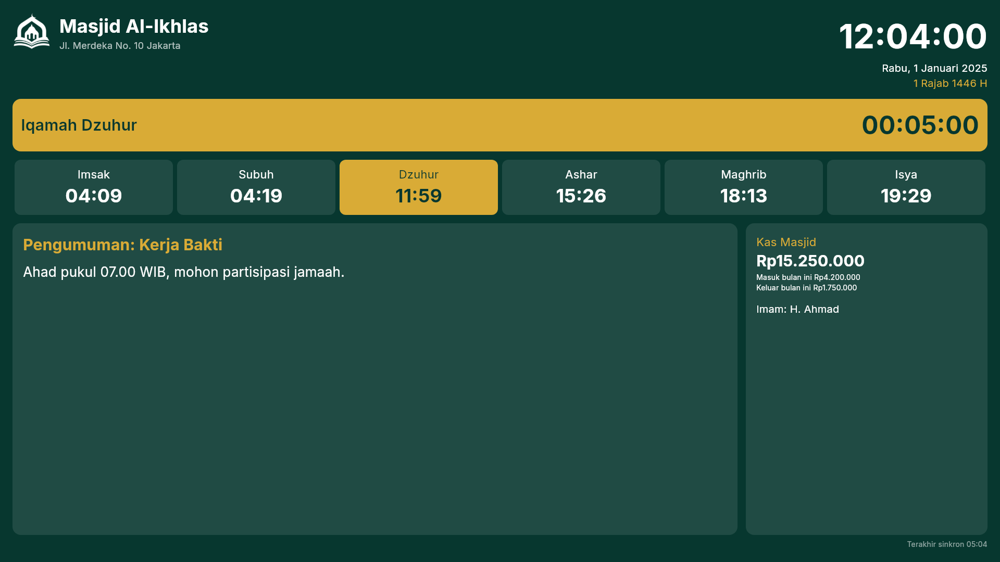
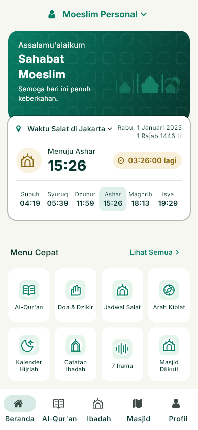
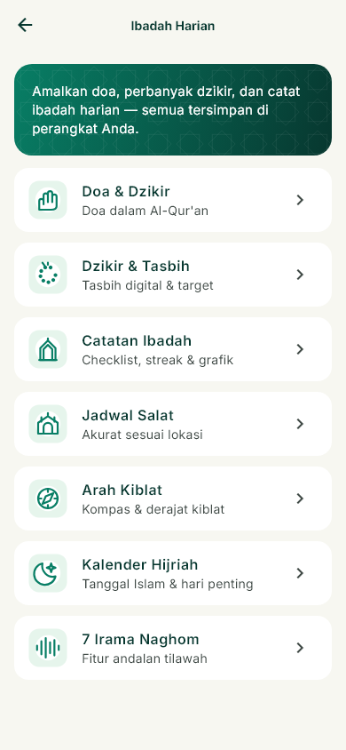
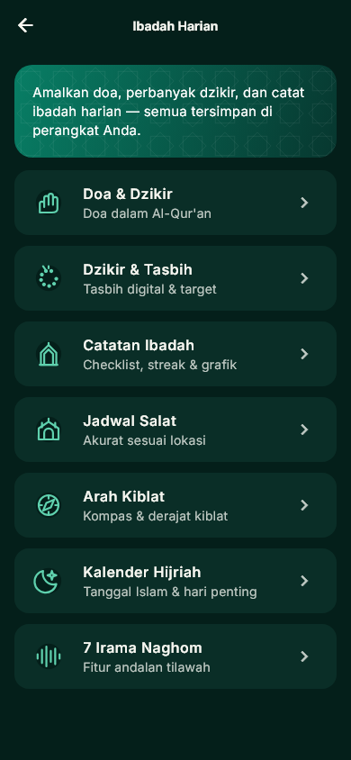
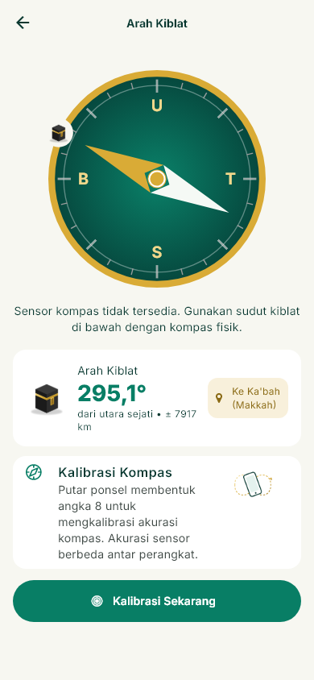

# Identitas Visual Moeslim PM: Personal & Mosque

Sumber: *Moeslim PM Brand Kit* (master SVG di `packages/moeslim_brand/brand-kit-src/`).
Semua aplikasi mengambil brand dari satu paket: **`packages/moeslim_brand`**: token warna, tema
Material 3 terang/gelap, tipografi **Inter** (dibundel, offline), dan widget `BrandLogo`.

 



## Palet & aturan kontras (WCAG ≥ 4.5:1 untuk teks)
| Token | Hex | Pemakaian |
|---|---|---|
| `BrandColors.emerald` | `#087E65` | Warna utama, tombol, kartu jadwal. Teks putih di atasnya 5.0:1 |
| `BrandColors.deep` | `#07372F` | Latar gelap, TV Display, teks utama di cream (12.2:1) |
| `BrandColors.dark` | `#06473D` | Latar gelap sekunder |
| `BrandColors.gold` | `#D9AB36` | **Aksen saja.** Sebagai teks hanya di atas deep/dark (6.2 / 5.0:1) |
| `BrandColors.cream` | `#F7F7F1` | Latar terang; teks sekunder di atas emerald (4.7:1) |
| `BrandColors.goldText` | `#8A6A14` | Turunan: teks bernuansa emas di latar terang (4.7:1) |
| `BrandColors.emeraldLight` | `#5FD1AE` | Turunan: warna utama di mode gelap |

Larangan yang diuji otomatis:
- Emas di atas putih/cream/emerald sebagai teks (2.0–2.35:1): hanya dekoratif (ikon bulan sabit, garis).
- Latar emas wajib teks **deep**, bukan putih (TV: banner iqamah & waktu aktif).

## Logo
| Varian | Pakai |
|---|---|
| `BrandLogo()` horizontal | AppBar Beranda; otomatis putih di mode gelap |
| `BrandLogoVariant.stacked` | Halaman login pengurus, Tentang & Lisensi |
| `BrandLogoVariant.symbol` | Header TV Display, ruang sempit |

Semua varian memiliki label aksesibilitas "Moeslim PM: Personal & Mosque". Pertahankan proporsi;
beri ruang kosong minimal 10% tinggi logo.

## Ikon & layar pembuka
- Android launcher: raster multi-density + adaptive icon (foreground/background 432) dari brand kit.
- Layar pembuka: cream + simbol (mode gelap: deep + simbol putih).
- TV Display: banner Android TV 320×180 (`drawable-xhdpi/tv_banner.png`), label "Moeslim PM Display".

## Tipografi
Inter 400/500/600/700/800 (SIL Open Font License 1.1, `packages/moeslim_brand/fonts/OFL-Inter.txt`),
dikonversi dari distribusi resmi `inter-ui`. Teks Arab Al-Qur'an memakai font mushaf terpisah (belum dipasang).
Gunakan `DefaultTextStyle.merge`, bukan `DefaultTextStyle(...)`, agar Inter dari tema tidak hilang.

## Catatan brand kit
Logo adalah redraw vektor dari konsep raster. Lakukan pengecekan keunikan/kemiripan merek sebelum
pendaftaran merek resmi.

## Asset kit (Moeslim PM Complete Asset Kit)
Aset dari *Moeslim PM Complete Asset Kit* dipasang di `packages/moeslim_brand` dan dipakai
lewat API berikut. Gambar bersifat dekoratif (tidak dibacakan pembaca layar); teks judul, huruf
mata angin, dan angka tetap dirender Flutter dengan Inter.

 
 

| Aset | API | Dipakai di |
|---|---|---|
| 120 ikon UI + 14 ikon Islami + 5 ikon waktu salat (font `MoeslimIcons`) | `Icon(MoeslimIcons.beranda)`, sama seperti `Icons.xxx` | Seluruh aplikasi & TV Display |
| 16 ilustrasi raster (masjid pagi, Al-Qur'an di rehal, Ramadan malam, manajemen masjid × 4) | `BrandArt(BrandIllustration.masjidPagi4)` | Onboarding, Registrasi Masjid, banner Ramadan di Kalender Hijriah |
| 13 ubin fitur | `FeatureTileArt(BrandTile.alquran)`, `MenuTile(tile: …)` | Menu Cepat Beranda, daftar Ibadah |
| 4 empty state | `BrandEmptyState(art: BrandEmptyArt.transaksi, title: …)` | Agenda, Keuangan, galat muat data Mosque |
| Dial & jarum kompas, kepala mushaf, bingkai & pemisah ayat, bulan-bintang, siluet masjid | `BrandElementArt(BrandElement.compassDial)` | Arah Kiblat |
| 10 latar (splash, Personal, Masjid, Ramadan, Al-Qur'an, banner, TV) | `BrandBackdrop(light: BrandBackground.personalTerang)` | tersedia |
| 8 pola geometris seamless | `BrandPattern.anyaman.decoration(color: …)` | tersedia |

- **Mode gelap:** SVG kit diwarnai ulang otomatis (`BrandDarkColorMapper`: mint → hijau malam,
  emerald → `emeraldLight`). Ilustrasi raster sudah berlatar transparan.
- **Tidak dipasang (sengaja):** kerangka tombol/kartu/input/toggle berisi teks contoh, kartu waktu salat
  `--:--`, kartu harga, cincin tasbih statis, grafik 7 hari, dan template TV; README kit sendiri meminta
  komponen ini dibuat native di Flutter (sudah ada di tema & layar). Chevron, panah tarik-turun, lingkaran
  kosong, dan beberapa ikon tanpa padanan di kit tetap memakai Material Icons.
- **Membangun ulang:**
  ```bash
  python -P tools/icons/build_icon_font.py                     # SVG di tools/icons/svg → MoeslimIcons.ttf + icons.dart
  python -P tools/asset_kit/import_kit.py <folder asset kit>    # ilustrasi, latar, pola, SVG fitur
  ```
- **Lisensi:** glyph ikon UI berasal dari Font Awesome 4 (Dave Gandy, SIL OFL 1.1),
  `packages/moeslim_brand/fonts/OFL-MoeslimIcons.txt`, atribusi tampil di *Tentang & Lisensi*.
