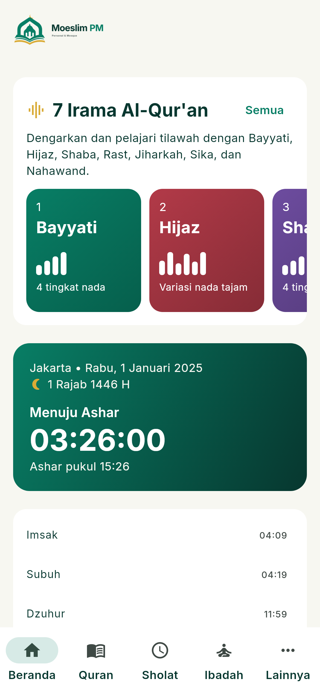
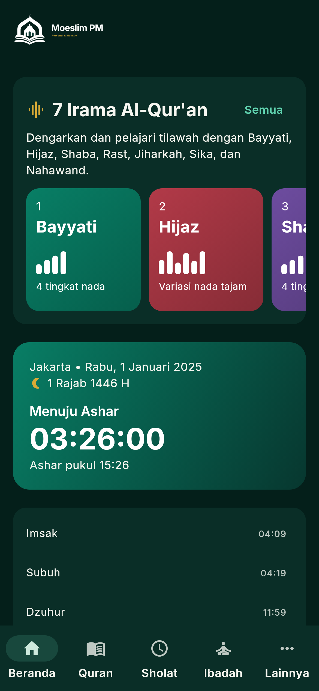

# Identitas Visual Moeslim PM — Personal & Mosque

Sumber: *Moeslim PM Brand Kit* (master SVG di `packages/moeslim_brand/brand-kit-src/`).
Semua aplikasi mengambil brand dari satu paket: **`packages/moeslim_brand`** — token warna, tema
Material 3 terang/gelap, tipografi **Inter** (dibundel, offline), dan widget `BrandLogo`.

 

## Palet & aturan kontras (WCAG ≥ 4.5:1 untuk teks)
| Token | Hex | Pemakaian |
|---|---|---|
| `BrandColors.emerald` | `#087E65` | Warna utama, tombol, kartu jadwal. Teks putih di atasnya 5.0:1 |
| `BrandColors.deep` | `#07372F` | Latar gelap, TV Display, teks utama di cream (12.2:1) |
| `BrandColors.dark` | `#06473D` | Latar gelap sekunder |
| `BrandColors.gold` | `#D9AB36` | **Aksen saja.** Sebagai teks hanya di atas deep/dark (6.2 / 5.0:1) |
| `BrandColors.cream` | `#F7F7F1` | Latar terang; teks sekunder di atas emerald (4.7:1) |
| `BrandColors.goldText` | `#8A6A14` | Turunan: teks bernuansa emas di latar terang (4.7:1) |
| `BrandColors.emeraldLight` | `#5FD1AE` | Turunan: warna utama di mode gelap |

Larangan yang diuji otomatis:
- Emas di atas putih/cream/emerald sebagai teks (2.0–2.35:1) — hanya dekoratif (ikon bulan sabit, garis).
- Latar emas wajib teks **deep**, bukan putih (TV: banner iqamah & waktu aktif).
- Teks putih di atas warna 7 irama ≥ 4.5:1 (Jiharkah `#9A5B0E`, Sika `#1F7272` disesuaikan).

## Logo
| Varian | Pakai |
|---|---|
| `BrandLogo()` horizontal | AppBar Beranda; otomatis putih di mode gelap |
| `BrandLogoVariant.stacked` | Halaman login pengurus, Tentang & Lisensi |
| `BrandLogoVariant.symbol` | Header TV Display, ruang sempit |

Semua varian memiliki label aksesibilitas "Moeslim PM — Personal & Mosque". Pertahankan proporsi;
beri ruang kosong minimal 10% tinggi logo.

## Ikon & layar pembuka
- Android launcher: raster multi-density + adaptive icon (foreground/background 432) dari brand kit.
- Layar pembuka: cream + simbol (mode gelap: deep + simbol putih).
- TV Display: banner Android TV 320×180 (`drawable-xhdpi/tv_banner.png`), label "Moeslim PM Display".

## Tipografi
Inter 400/500/600/700/800 (SIL Open Font License 1.1, `packages/moeslim_brand/fonts/OFL-Inter.txt`),
dikonversi dari distribusi resmi `inter-ui`. Teks Arab Al-Qur'an memakai font mushaf terpisah (belum dipasang).
Gunakan `DefaultTextStyle.merge`, bukan `DefaultTextStyle(...)`, agar Inter dari tema tidak hilang.

## Catatan brand kit
Logo adalah redraw vektor dari konsep raster. Lakukan pengecekan keunikan/kemiripan merek sebelum
pendaftaran merek resmi.
