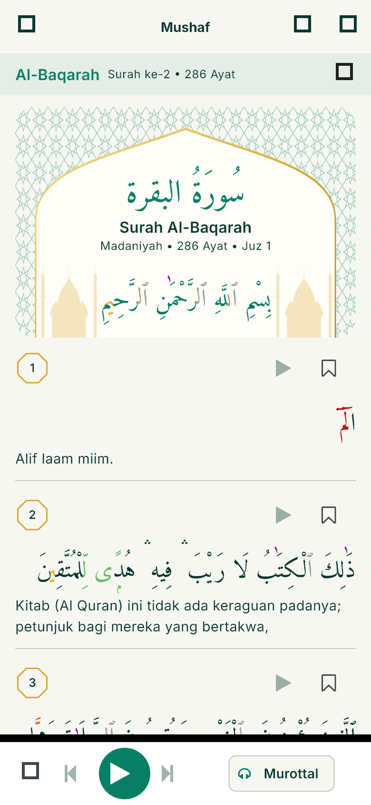
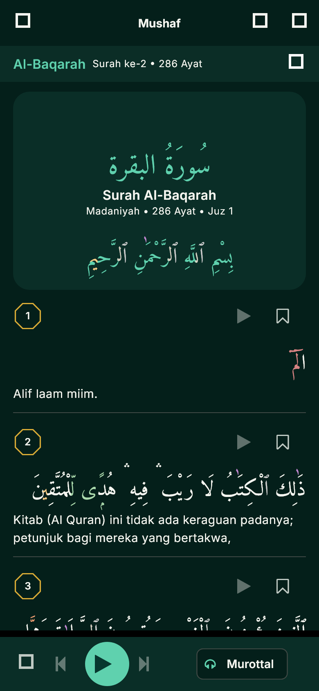

# Pewarnaan Tajwid pada Teks Al-Qur'an

Huruf hijaiyah diwarnai sesuai hukum tajwid (18 aturan: hamzah washal, lam syamsiyah, ghunnah,
idgham bighunnah/bilaghunnah/mutajanisain/mutaqaribain/mimi, ikhfa' haqiqi/syafawi, iqlab,
qalqalah, mad thabi'i/jaiz munfashil/wajib muttashil/lazim/'aridh lissukun, huruf tidak dibaca).
Pengguna dapat mematikan pewarnaan (ikon di halaman surah) dan membuka **Panduan Warna Tajwid**.

## Status: seluruh 114 surah (6.236 ayat) sudah berwarna
Anotasi dibuat saat build oleh **pengklasifikasi tajwid Moeslim PM**
(`packages/personal_core/lib/src/content/tajweed_classifier.dart`) atas teks Tanzil Uthmani yang
terpasang, lalu disimpan di aset (`tj` per ayat, `[awal, akhir, indeks aturan]`). Hasil saat ini:
59.081 rentang warna; ke-18 aturan muncul.

 

```bash
cd packages/personal_core
dart run tool/annotate_tajweed.dart        # tulis ulang kolom tj di apps/mobile/assets/quran/*.json
dart run tool/tajweed_preview.dart 2 6     # lihat rentang & aturan per ayat untuk telaah
dart test test/tajweed_classifier_test.dart
```

### Kesetaraan dengan cpfair/quran-tajweed
Semantik disamakan dengan classifier cpfair (data CC BY 4.0; kodenya tanpa lisensi sehingga **tidak disalin** —
logika ditulis ulang):
- Model huruf: huruf dasar + tanda (Mn); spasi dihitung sebagai "huruf"; alif kecil (U+0670) berdiri sendiri.
- Nama & cakupan rentang tiap aturan sama (mis. ikhfa dari nun/tanwin sampai harakat huruf sesudahnya;
  mad lazim/muttashil/munfashil = huruf mad + tanda maddah; ghunnah = seluruh huruf bertasydid).
- Konvensi Tanzil: huruf yang melebur ditulis tanpa sukun, iqlab bertanda mim kecil, huruf tak dibaca bertanda
  U+06DF, mad panjang bertanda U+0653. Seperti cpfair, mad thabi'i hanya diwarnai pada alif/wau/ya kecil, dan
  mad 'aridh lissukun hanya di akhir ayat.
- Vektor uji: keluaran cpfair untuk Al-Fatihah ayat 1 cocok persis.
- Penyesuaian untuk edisi teks ini: tanda mim kecil (U+06ED) juga dipakai pada tanwin non-izhar, sehingga iqlab
  hanya diberikan bila huruf sesudahnya ب; lafaz Allah di akhir ayat dikecualikan dari lam syamsiyah.

Warna mode gelap diturunkan otomatis (dicampur 45% putih) agar tetap kontras.

## Arsitektur: berbasis anotasi
Warna berasal dari **anotasi** (dibuat classifier di atas, atau dataset luar) — daftar rentang `(awal, akhir, aturan)` per ayat — yang
diimpor bersama teks:

```bash
dart run tool/import_quran.dart <teks.txt> <output-dir> [terjemahan.txt] --tajweed anotasi.json
```

Format anotasi: `[{"surah": 1, "ayah": 1, "annotations": [{"rule": "ikhfa", "start": 10, "end": 14}]}]`
(nama aturan: `hamzat_wasl, lam_shamsiyyah, silent, ghunnah, idghaam_ghunnah, idghaam_no_ghunnah,
idghaam_mutajanisayn, idghaam_mutaqaribayn, idghaam_shafawi, ikhfa, ikhfa_shafawi, iqlab, qalqalah,
madd_2, madd_munfasil, madd_muttasil, madd_6, madd_246`).

Pengaman: aturan tak dikenal dilaporkan; impor **dibatalkan** bila ada posisi di luar panjang teks ayat
(tanda anotasi dibuat untuk edisi teks berbeda).

| Pendekatan | Pro | Kontra |
|---|---|---|
| Anotasi dataset (dipilih) | Akurat sesuai telaah, dapat diaudit, ringan di perangkat | Butuh dataset yang cocok dengan edisi teks |
| Mesin aturan di aplikasi | Tidak butuh dataset | Rasm Utsmani, waqaf, dan pengecualian membuat salah warna = salah ajar |

## Yang perlu ditetapkan penelaah
1. **Edisi teks**: anotasi harus dibuat untuk edisi yang sama. Mushaf Standar Indonesia (Kemenag) berbeda
   konvensi penulisan dengan mushaf Madinah/Tanzil, sehingga anotasi untuk Tanzil tidak otomatis cocok.
   Contoh dataset terbuka untuk teks Tanzil: proyek `quran-tajweed` (cpfair) — periksa lisensinya dan
   cocokkan edisinya. Karena Moeslim Personal non-komersial (ADR 0005), dataset berlisensi terbuka/
   non-komersial dapat dipakai dengan atribusi sesuai ketentuannya.
2. **Palet warna**: satu sumber di `packages/personal_core/lib/src/content/tajweed.dart`; selaraskan dengan
   konvensi mushaf tajwid yang dirujuk agar pengguna tidak bingung.
3. **Uji render** di perangkat: pastikan pewarnaan per huruf tidak memutus sambungan huruf Arab pada font
   mushaf yang dipilih.
