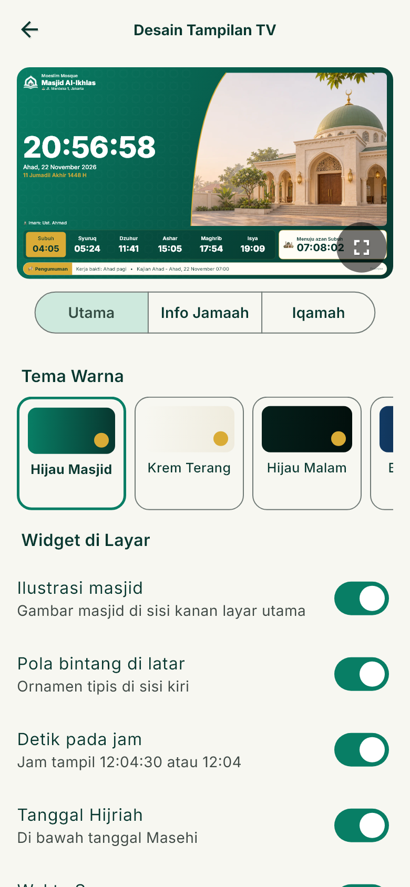
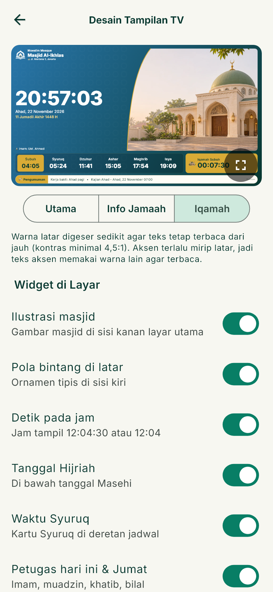
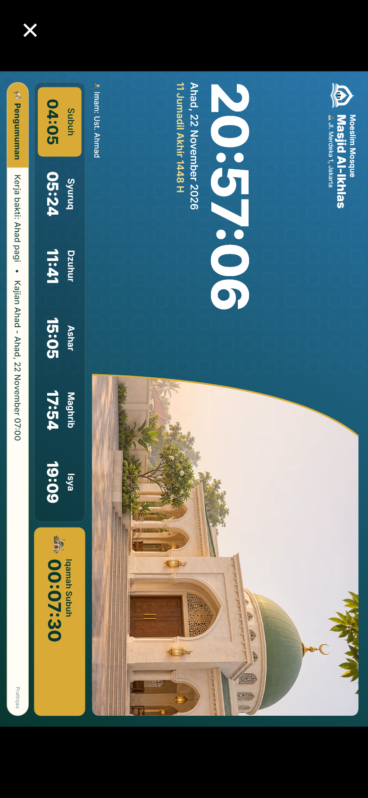

# Desain Tampilan TV Display

Pengurus mengatur tampilan setiap TV dari aplikasi: **Mosque → Akun → Konfigurasi TV Display → pilih TV →
Desain & Pratinjau Tampilan**. Pratinjau di HP memakai widget yang sama persis dengan aplikasi TV
(`packages/display_ui`, `TvStage`) dan data asli masjid, jadi yang terlihat di HP adalah yang tampil di TV.

 

## Yang bisa diatur
| Pengaturan | Kunci `device.config` | Nilai |
|---|---|---|
| Tema warna | `theme` | `auto` (Hijau Masjid), `light` (Krem Terang), `dark` (Hijau Malam), `navy` (Biru Malam), `maroon` (Merah Marun), `custom` |
| Warna sendiri | `custom_background`, `custom_background_2`, `custom_accent` | `#RRGGBB` |
| Ilustrasi masjid, pola latar, detik jam, Hijriah, Syuruq, petugas, bilah pengumuman, Layar Informasi Jamaah | `show_illustration`, `show_pattern`, `show_seconds`, `show_hijri`, `show_sunrise`, `show_staff`, `show_ticker`, `show_info_screen` | `true`/`false` (bawaan `true`) |
| Lama Layar Informasi per menit | `info_seconds` | 10, 20, 30 |
| Jam besar | `large_clock` | `true`/`false` |
| Teks berjalan tambahan | `ticker_text` | maks. 160 karakter |

Kunci lama (`language`, `rotation_seconds`) tetap dipakai. Opsi "Terapkan ke semua TV" menyimpan desain yang
sama ke setiap TV aktif. TV mengambil pengaturan baru pada sinkron berikutnya (paling lama 1 menit).

## Keterbacaan
- Warna teks dipilih otomatis (putih atau hijau tua) dan dijamin kontras minimal 4,5:1 terhadap latar.
  Bila latar pilihan pengurus berwarna tengah (mis. biru sedang), warnanya digeser sedikit dan editor memberi tahu.
- Aksen dipakai sebagai teks hanya bila kontrasnya ≥ 3:1 (teks besar); jika tidak, dipakai emas atau warna teks.
- Teks di atas aksen memakai hijau tua atau putih, mana yang lebih kontras.

## API
- `PATCH /api/mosques/{id}/displays/{device}` dengan `{"config": {...}}`: validasi & allowlist di
  `DisplayController::CONFIG_KEYS`; perubahan dicatat di audit (`display.design_updated`).
- `GET /api/mosques/{id}/displays/preview`: konten yang sama dengan `/api/display/content` untuk pratinjau.
- `GET /api/mosques/{id}/displays/qris-image`: gambar QRIS untuk pratinjau.

## TV Web (`/tv`)
TV Web mengikuti tema (termasuk Biru Malam, Merah Marun, dan warna sendiri) serta opsi sembunyikan Hijriah
dan detik. Widget lain di daftar atas khusus aplikasi TV Android.
